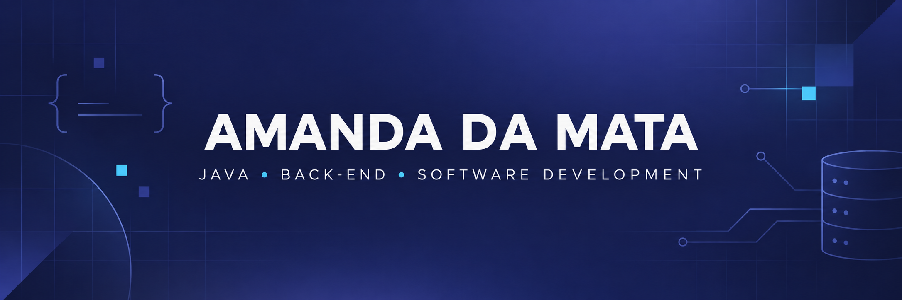
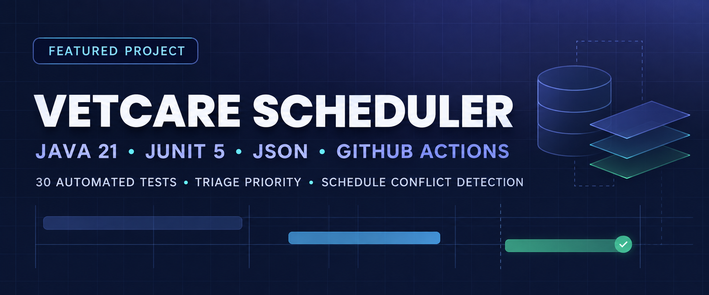

  

  
  
  

## About me

I'm a Systems Analysis and Development student in Brazil, currently focused on **Java and back-end fundamentals**. I began studying programming before starting my degree and am now turning that foundation into practical, tested, and documented projects.

| | |
|---|---|
| **Main focus** | Java, object-oriented programming, and back-end development |
| **How I learn** | Building projects with business rules, persistence, tests, and documentation |
| **What I'm looking for** | My first software development internship, especially with Java and back-end |

## Featured project

  
  
  
  

**VetCare Scheduler** is a command-line application for veterinary appointment management. I used a familiar domain to practice software development through real rules rather than a basic CRUD exercise.

- Calculates `EMERGENCY`, `URGENT`, and `STANDARD` triage priority
- Prevents overlapping appointments while allowing adjacent time slots
- Persists clinic data locally as JSON
- Separates models, repositories, services, persistence, and the CLI
- Runs 30 automated tests with JUnit 5 and continuous integration

**[Explore the code](https://github.com/Amandadamata/vetcare-scheduler-java)** · **[Read the project walkthrough](https://github.com/Amandadamata/vetcare-scheduler-java/blob/main/docs/PROJECT_WALKTHROUGH.md)** · **[View the CI](https://github.com/Amandadamata/vetcare-scheduler-java/actions)**

## Tech stack

### Building with

  
  
  
  
  
  

### Foundations and current learning

  
  
  
  

I describe these as foundations or current learning intentionally: my goal is to show real progress without presenting theoretical knowledge as professional experience.

## Beyond code

Before moving into technology, I worked as an English teacher. That experience strengthened my communication, organization, and ability to explain ideas clearly. My previous academic background also inspired the domain of VetCare Scheduler, while the project itself remains focused on software engineering.

## GitHub activity

  

## Let's connect

I'm looking for my first internship opportunity in software development, where I can continue learning while contributing to a team and real projects.

**[Connect with me on LinkedIn](https://www.linkedin.com/in/amanda-da-mata-492106288/)**
