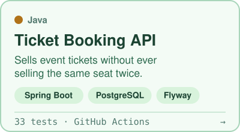
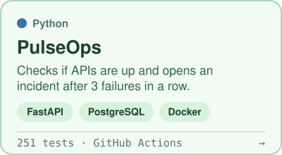
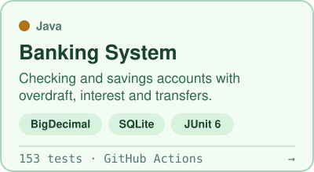
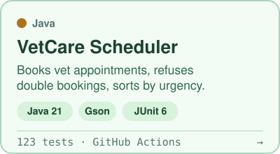

<strong>English</strong> · <a href="README.pt-BR.md">Português</a>

  

  
  
  

Hi, I'm Amanda 👋

I'm a back-end developer in training. I write Java and Python, and the part I enjoy most is turning a messy real-world rule into code with tests that prove it works.

Before tech, I taught English for two years, at Yázigi and Red Balloon. I work in English comfortably (B2, Duolingo English Test 125), and teaching left me with habits I now use in code every day. There's more about that below.

I'm in my first semester of Systems Analysis and Development at UNINTER, and I live in Goiânia, Brazil. I'm looking for a remote internship or a junior back-end role, full-time or part-time. Remote work is a real commitment for me: I've taught online, I organize my own work every day, and I can work European business hours. I plan to study IT in Italy and I'm preparing for the CEnT-S, the admission test for Italian universities, so I'm also open to relocating.

## Projects

  <a href="https://github.com/Amandadamata/ticket-booking-api"><picture><source media="(prefers-color-scheme: dark)" srcset="https://raw.githubusercontent.com/Amandadamata/Amandadamata/main/assets/card-tickets-en-dark.svg"></picture></a>
  <a href="https://github.com/Amandadamata/Pulse-Ops"><picture><source media="(prefers-color-scheme: dark)" srcset="https://raw.githubusercontent.com/Amandadamata/Amandadamata/main/assets/card-pulseops-en-dark.svg"></picture></a>

  <a href="https://github.com/Amandadamata/sistema-bancario-java"><picture><source media="(prefers-color-scheme: dark)" srcset="https://raw.githubusercontent.com/Amandadamata/Amandadamata/main/assets/card-banking-en-dark.svg"></picture></a>
  <a href="https://github.com/Amandadamata/vetcare-scheduler-java"><picture><source media="(prefers-color-scheme: dark)" srcset="https://raw.githubusercontent.com/Amandadamata/Amandadamata/main/assets/card-vetcare-en-dark.svg"></picture></a>

Click a card to open the project. VetCare was my first project, built for a veterinary clinic in Goiânia from requirements I gathered with the team. PulseOps was generated with Claude Code from a spec I wrote, and its README says which part was mine and which was the AI's.

## From the classroom to the code

| When I taught English, I... | Now, in my code, I... |
|---|---|
| explained the same grammar point to students of different ages and levels, each in a different way. | write READMEs for two readers: someone skimming for a minute, and a developer who wants the details. |
| planned every lesson around one clear goal, in small steps. | split work into branches and pull requests, and start each one by saying what it's for. |
| corrected homework with specific comments, not just a grade. | write commit messages and PR notes that say what changed and why. |
| taught in English every day. | can explain my projects, discuss trade-offs and join meetings in English. |

<b>In a hurry? Here's the 30-second version</b>

 

- **Code:** Java (3 projects, 309 JUnit 6 tests, one in Spring Boot) and Python (1 project, 251 pytest tests)
- **Also used in my projects:** SQL with PostgreSQL and SQLite, Flyway, Maven, Git, GitHub Actions, Docker
- **English:** B2 (Duolingo English Test 125), two years teaching it
- **Studying:** ADS at UNINTER (1st semester), and the CEnT-S, because I plan to study IT in Italy
- **Looking for:** a remote internship or junior back-end role, full-time or part-time, in European hours if needed. Open to relocating

<b>Questions I'd love to get in an interview</b>

 

- How do you stop two people from buying the last seat at the same moment? ([Ticket Booking API](https://github.com/Amandadamata/ticket-booking-api))
- What makes it safe for an app to send the same purchase twice? ([Ticket Booking API](https://github.com/Amandadamata/ticket-booking-api))
- Why should money never be a `double`? ([Banking System](https://github.com/Amandadamata/sistema-bancario-java))
- How do you check whether two time slots overlap, in one line? ([VetCare](https://github.com/Amandadamata/vetcare-scheduler-java))
- How does PulseOps decide that an API is really down, and not just slow? ([PulseOps](https://github.com/Amandadamata/Pulse-Ops))

## Tech stack

  <b>Languages</b> 
  <picture>
    <source media="(prefers-color-scheme: dark)" srcset="https://skillicons.dev/icons?i=java%2Cpython&theme=dark">
    
  </picture>

  <b>Frameworks · Spring Boot, Spring Data JPA, FastAPI</b> 
  <picture>
    <source media="(prefers-color-scheme: dark)" srcset="https://skillicons.dev/icons?i=spring%2Cfastapi&theme=dark">
    
  </picture>

  <b>Testing & build · JUnit 6, pytest, Maven, GitHub Actions</b> 
  <picture>
    <source media="(prefers-color-scheme: dark)" srcset="https://skillicons.dev/icons?i=maven%2Cgithubactions&theme=dark">
    
  </picture>

  <b>Databases · PostgreSQL and SQLite, with Flyway migrations</b> 
  <picture>
    <source media="(prefers-color-scheme: dark)" srcset="https://skillicons.dev/icons?i=postgres%2Csqlite&theme=dark">
    
  </picture>

  <b>Cloud & containers · Docker, plus AWS, Azure and Oracle Cloud fundamentals</b> 
  <picture>
    <source media="(prefers-color-scheme: dark)" srcset="https://skillicons.dev/icons?i=docker%2Caws%2Cazure&theme=dark">
    
  </picture>

  <b>Tools</b> 
  <picture>
    <source media="(prefers-color-scheme: dark)" srcset="https://skillicons.dev/icons?i=idea%2Cvscode%2Cgit%2Cgithub%2Cpostman&theme=dark">
    
  </picture>

## Things you'll find in my repos

- Tests next to the code, including parameterized tests for invalid input and tests for requests that arrive at the same time.
- A GitHub Actions workflow that runs the tests on every push.
- A section in each README listing what the project doesn't do yet.

AI is part of how I work. I use ChatGPT, Codex and Claude to write and review code, track down bugs and study, and the commits show it.

  <picture>
    <source media="(prefers-color-scheme: dark)" srcset="https://raw.githubusercontent.com/Amandadamata/Amandadamata/output/snake-dark.svg">
    
  </picture>

## Education & courses

**Systems Analysis and Development (ADS)** · UNINTER · 2026 to present

- **Java and Spring:** Building a REST API with Spring Boot (Spring Academy) · Java Explorer (Oracle)
- **Cloud:** Azure fundamentals (Microsoft Learn) · OCI Architect Associate learning path (Oracle) · Cloud Computing (AWS Skill Builder)
- **Python:** CS50P (Harvard) · Python Essentials 1 and 2 (Cisco Networking Academy)
- **Databases:** CS50 SQL (Harvard) · Relational Database (freeCodeCamp)
- **Web, APIs and tools:** Full Stack Open (University of Helsinki) · API Fundamentals Student Expert (Postman) · Git and GitHub Actions (GitHub Skills)

## Let's talk

I answer in English or Portuguese.

