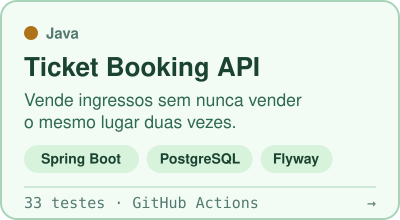
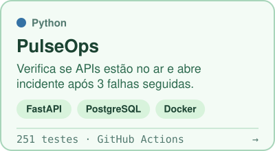
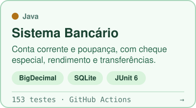
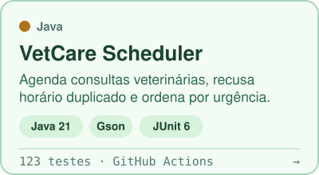

<a href="README.md">English</a> · <strong>Português</strong>

  

  
  
  

Oi, eu sou a Amanda 👋

Sou desenvolvedora back-end em formação. Programo em Java e Python, e o que eu mais gosto é pegar uma regra bagunçada do mundo real e transformar em código, com testes que provam que ela funciona.

Antes da tecnologia, dei aula de inglês por dois anos, no Yázigi e na Red Balloon. Trabalho em inglês com tranquilidade (B2, Duolingo English Test 125), e a sala de aula me deixou hábitos que uso no código todos os dias. Conto mais sobre isso logo abaixo.

Estou no primeiro semestre de Análise e Desenvolvimento de Sistemas na UNINTER e moro em Goiânia (GO). Procuro estágio ou vaga júnior remota em back-end. Também estou me preparando para o CEnT-S, a prova de admissão das universidades italianas, para começar uma faculdade de TI na Itália em 2027, então também tenho interesse em vagas presenciais por lá.

## Projetos

  <a href="https://github.com/Amandadamata/ticket-booking-api"><picture><source media="(prefers-color-scheme: dark)" srcset="https://raw.githubusercontent.com/Amandadamata/Amandadamata/main/assets/card-tickets-pt-dark.svg"></picture></a>
  <a href="https://github.com/Amandadamata/Pulse-Ops/blob/main/README.pt-BR.md"><picture><source media="(prefers-color-scheme: dark)" srcset="https://raw.githubusercontent.com/Amandadamata/Amandadamata/main/assets/card-pulseops-pt-dark.svg"></picture></a>

  <a href="https://github.com/Amandadamata/sistema-bancario-java/blob/main/README.pt-BR.md"><picture><source media="(prefers-color-scheme: dark)" srcset="https://raw.githubusercontent.com/Amandadamata/Amandadamata/main/assets/card-banking-pt-dark.svg"></picture></a>
  <a href="https://github.com/Amandadamata/vetcare-scheduler-java/blob/main/README.pt-BR.md"><picture><source media="(prefers-color-scheme: dark)" srcset="https://raw.githubusercontent.com/Amandadamata/Amandadamata/main/assets/card-vetcare-pt-dark.svg"></picture></a>

Clique num card para abrir o projeto. O PulseOps foi gerado com o Claude Code a partir de uma especificação que eu escrevi, e o README dele explica o que foi feito por mim e o que foi feito pela IA.

## Da sala de aula para o código

| Quando eu dava aula de inglês, eu... | Hoje, no código, eu... |
|---|---|
| explicava o mesmo ponto de gramática para alunos de idades e níveis diferentes, cada um de um jeito. | escrevo READMEs para dois leitores: quem vai passar o olho em um minuto e quem quer os detalhes. |
| planejava cada aula em torno de um objetivo claro, em pequenos passos. | divido o trabalho em branches e pull requests, e começo cada um dizendo para que ele serve. |
| corrigia as tarefas com comentários específicos, não só com uma nota. | escrevo mensagens de commit e de PR que dizem o que mudou e por quê. |
| dava aula em inglês todos os dias. | consigo explicar meus projetos, discutir prós e contras e participar de reuniões em inglês. |

<b>Com pressa? A versão de 30 segundos</b>

 

- **Código:** Java (3 projetos, 309 testes JUnit 6, um deles em Spring Boot) e Python (1 projeto, 251 testes com pytest)
- **Também uso nos projetos:** SQL com PostgreSQL e SQLite, Flyway, Maven, Git, GitHub Actions, Docker
- **Inglês:** B2 (Duolingo English Test 125), dois anos dando aula
- **Estudando:** ADS na UNINTER (1º semestre) e o CEnT-S, para estudar TI na Itália a partir de 2027
- **Procuro:** estágio ou vaga júnior remota em back-end, ou presencial na Itália

<b>Perguntas que eu adoraria receber numa entrevista</b>

 

- Como impedir que duas pessoas comprem o último lugar no mesmo instante? ([Ticket Booking API](https://github.com/Amandadamata/ticket-booking-api))
- O que torna seguro um aplicativo enviar a mesma compra duas vezes? ([Ticket Booking API](https://github.com/Amandadamata/ticket-booking-api))
- Por que dinheiro nunca deve ser `double`? ([Sistema Bancário](https://github.com/Amandadamata/sistema-bancario-java/blob/main/README.pt-BR.md))
- Como saber se dois horários se sobrepõem, numa linha só? ([VetCare](https://github.com/Amandadamata/vetcare-scheduler-java/blob/main/README.pt-BR.md))
- Como o PulseOps decide que uma API caiu de verdade, e não está só lenta? ([PulseOps](https://github.com/Amandadamata/Pulse-Ops/blob/main/README.pt-BR.md))

## Tecnologias

  <b>Linguagens</b> 
  <picture>
    <source media="(prefers-color-scheme: dark)" srcset="https://skillicons.dev/icons?i=java%2Cpython&theme=dark">
    
  </picture>

  <b>Frameworks · Spring Boot, Spring Data JPA, FastAPI</b> 
  <picture>
    <source media="(prefers-color-scheme: dark)" srcset="https://skillicons.dev/icons?i=spring%2Cfastapi&theme=dark">
    
  </picture>

  <b>Testes e build · JUnit 6, pytest, Maven, GitHub Actions</b> 
  <picture>
    <source media="(prefers-color-scheme: dark)" srcset="https://skillicons.dev/icons?i=maven%2Cgithubactions&theme=dark">
    
  </picture>

  <b>Bancos de dados · PostgreSQL e SQLite, com migrações no Flyway</b> 
  <picture>
    <source media="(prefers-color-scheme: dark)" srcset="https://skillicons.dev/icons?i=postgres%2Csqlite&theme=dark">
    
  </picture>

  <b>Nuvem e containers · Docker, além de fundamentos de AWS, Azure e Oracle Cloud</b> 
  <picture>
    <source media="(prefers-color-scheme: dark)" srcset="https://skillicons.dev/icons?i=docker%2Caws%2Cazure&theme=dark">
    
  </picture>

  <b>Ferramentas</b> 
  <picture>
    <source media="(prefers-color-scheme: dark)" srcset="https://skillicons.dev/icons?i=idea%2Cvscode%2Cgit%2Cgithub%2Cpostman&theme=dark">
    
  </picture>

## O que você vai encontrar nos meus repositórios

- Testes junto com o código, incluindo testes parametrizados para entradas inválidas e testes com pedidos que chegam ao mesmo tempo.
- Um workflow do GitHub Actions que roda os testes a cada push.
- Uma seção em cada README com o que o projeto ainda não faz.

A IA faz parte do meu jeito de trabalhar. Uso ChatGPT, Codex e Claude para escrever e revisar código, achar bugs e estudar, e os commits mostram isso.

  <picture>
    <source media="(prefers-color-scheme: dark)" srcset="https://raw.githubusercontent.com/Amandadamata/Amandadamata/output/snake-dark.svg">
    
  </picture>

## Formação e cursos

**Análise e Desenvolvimento de Sistemas (ADS)** · UNINTER · 2026 até o momento

- **Java e Spring:** Building a REST API with Spring Boot (Spring Academy) · Java Explorer (Oracle)
- **Nuvem:** fundamentos de Azure (Microsoft Learn) · trilha OCI Architect Associate (Oracle) · Cloud Computing (AWS Skill Builder)
- **Python:** CS50P (Harvard) · Python Essentials 1 e 2 (Cisco Networking Academy)
- **Bancos de dados:** CS50 SQL (Harvard) · Relational Database (freeCodeCamp)
- **Web, APIs e ferramentas:** Full Stack Open (Universidade de Helsinque) · API Fundamentals Student Expert (Postman) · Git e GitHub Actions (GitHub Skills)

## Vamos conversar

Respondo em português ou em inglês.

